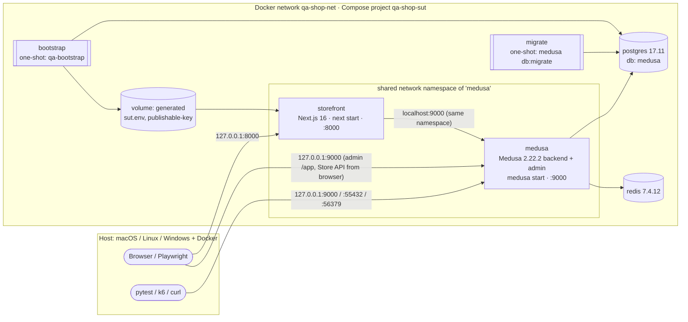

# Architecture

## Start-up order

| Step | Service | Waits for | Does |
|---|---|---|---|
| 1 | `postgres`, `redis` | — | Healthchecks `pg_isready`, `redis-cli ping` |
| 2 | `migrate` | 1 healthy | `medusa db:migrate`: schema, link sync, and the starter seed (a migration script that runs once) |
| 3 | `medusa` | 2 completed successfully | `medusa start` in production mode; healthcheck `GET /health` |
| 4 | `bootstrap` | 3 healthy | `medusa exec qa-bootstrap.js`: QA region, products, inventory, search index, admin, key lookup, read-only role, contract |
| 5 | `storefront` | 4 completed successfully | Copies the pristine Next.js build, writes in the publishable key and URLs, `next start`; healthcheck `GET /dk` |

`make up` runs `docker compose up -d --build --wait`, then copies `/generated/sut.env` out of the volume
to `.generated/sut.env` (`make contract`).

## Ports (127.0.0.1 only, configurable in `.env`)

| Port | Service | Variable |
|---|---|---|
| 9000 | Medusa backend + admin (`/app`) | `SHOP_BACKEND_PORT` |
| 8000 | Storefront (published by `medusa`, see ADR-002) | `SHOP_STOREFRONT_PORT` |
| 55432 | PostgreSQL | `SHOP_POSTGRES_PORT` |
| 56379 | Redis | `SHOP_REDIS_PORT` |

The backend and the storefront listen inside the containers on the same port numbers as on the host,
so overriding a port keeps `http://localhost:<port>` valid for both the browser and the Next.js server.

## Images

| Image | Built from | Contents |
|---|---|---|
| `qa-shop-sut/backend:local` | `docker/backend.Dockerfile` | `pnpm install --frozen-lockfile` (backend only) → `medusa build` → runs from `.medusa/server` |
| `qa-shop-sut/storefront:local` | `docker/storefront.Dockerfile` | `next build` with placeholders → `.next-template`; entrypoint substitutes them at start |

Both use `node:22.23.4-bookworm-slim` (multi-arch: amd64 and arm64) and pnpm 10.11.1 via Corepack.

## Data

See [test-data-contract.md](test-data-contract.md).
